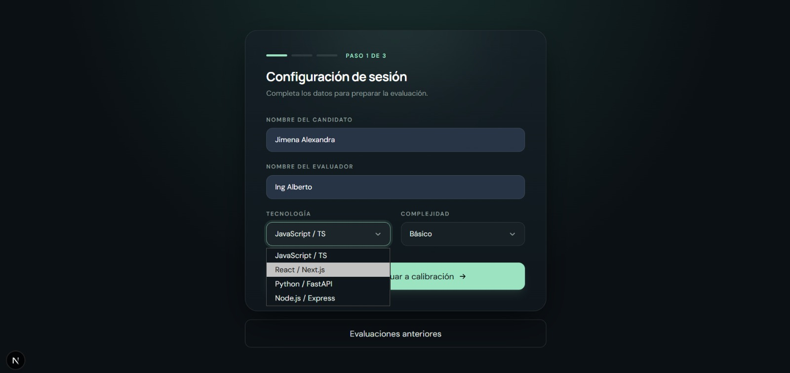
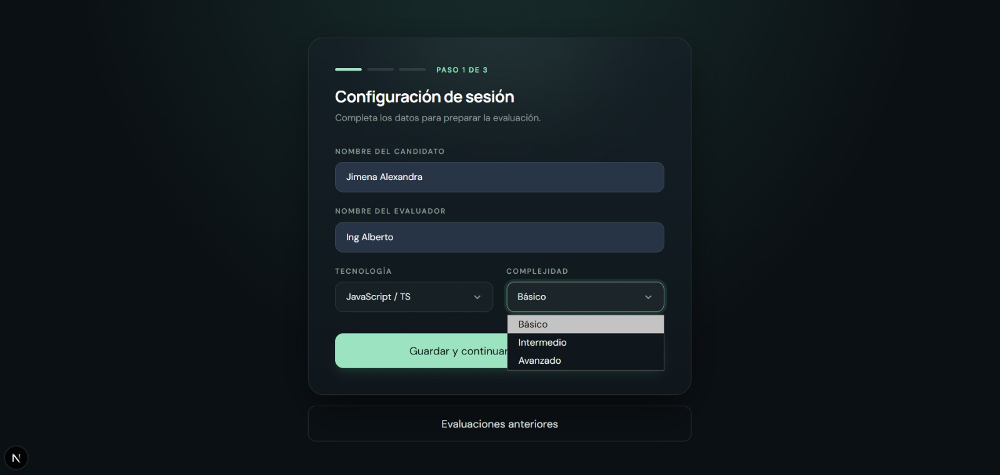
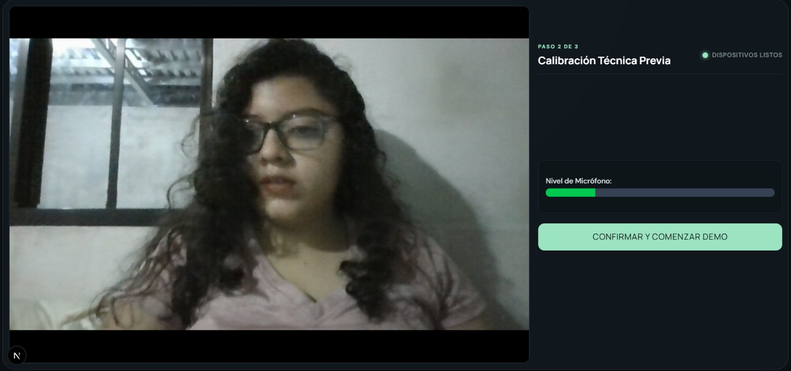
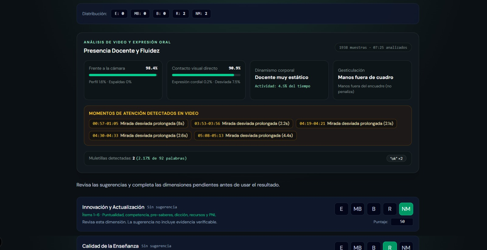
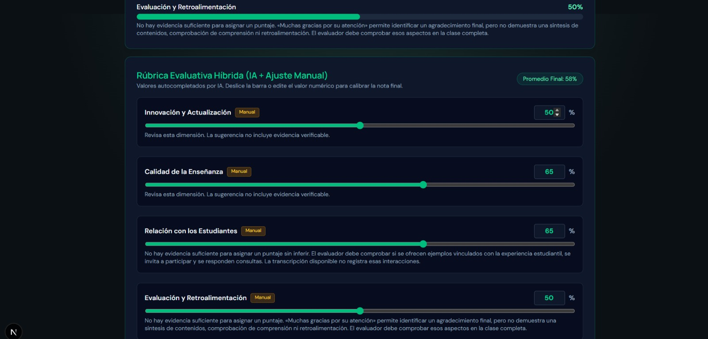
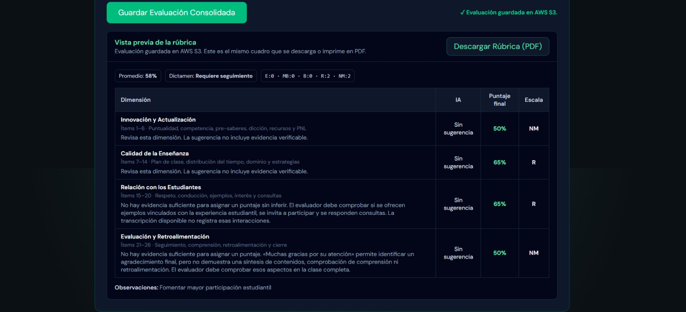

# DevDemo Class

Sistema de apoyo a evaluaciones de clases demo en la Universidad de Oriente (UNIVO). Se desarrolló un prototipo web para grabar la sesión, transcribir el audio, analizar la postura y el rostro, detectar vocabulario técnico y muletillas, y completar una rúbrica consolidada con descarga en PDF.

## De qué va el sistema

Se implementó un flujo de evaluación en el que un evaluador registra al candidato, calibra cámara y micrófono, graba la clase demo y obtiene:

- transcripción en vivo y transcripción final de la grabación
- análisis corporal y facial (movilidad, orientación, contacto visual, gestos)
- glosario de términos técnicos agrupado por tecnología
- conteo de muletillas
- rúbrica UNIVO (sugerencias, ajuste manual, dictamen y observaciones)
- historial de evaluaciones, galería de grabaciones y borrado de la carpeta de un candidato
- almacenamiento de videos y rúbricas en Amazon S3 (`recordings/{sesión}/`)

Se realizó el frontend en Next.js y el backend en FastAPI. El navegador habla con la API en `http://127.0.0.1:8000`.

## Lenguajes utilizados

- **TypeScript / JavaScript** — interfaz (React, Next.js)
- **Python** — API, transcripción, PNL, MediaPipe y S3
- **HTML / CSS** — vistas e impresión/PDF de la rúbrica
- **JSON** — rúbrica UNIVO, evaluaciones y catálogo de sesiones

## Herramientas y tecnologías

| Área | Herramientas |
| --- | --- |
| Frontend | Next.js 16, React 19, Tailwind CSS, jsPDF |
| Backend | FastAPI, Uvicorn, Python 3.12 |
| IA / PNL | OpenAI (transcripción y sugerencias de rúbrica), spaCy |
| Visión | MediaPipe, OpenCV |
| Nube | AWS S3 (boto3) |
| Entorno | Node.js, npm, venv de Python, Git / GitHub |


### Vista previa del sistema

1. Al abrir http://localhost:3036
2. Completar datos de sesión (nombre de candidato, nombre de evaluador, seleccionar tecnología, seleccionar complejidad)


3. Calibrar cámara y micrófono;

4. Grabar el video

5. Consolidacion de evaluacion, donde se muestra el analisis de video y expresion oral, Metricas de desempeño cuantitativo y la Rubrica Evaluativa (El evaluador puede editarlo manualmente)





6. Guardar la evaluación (en pantalla se muestra la rúbrica y se puede descargar PDF)

7. En Evaluaciones anteriores se listan las carpetas locales y se puede eliminar la de un candidato.


## Estructura breve

```
DevDemo_Class/
  main.py                 API FastAPI
  transcriber.py          Transcripción y catálogo local recordings/
  pose_analyzer.py        Análisis corporal
  vocab_extractor.py      Vocabulario técnico y muletillas
  s3_storage.py           Videos y evaluaciones en S3
  rubric.py               Sugerencias de rúbrica
  frontend/               Next.js (grabación, rúbrica, galería)
  recordings/             Historial local 
```